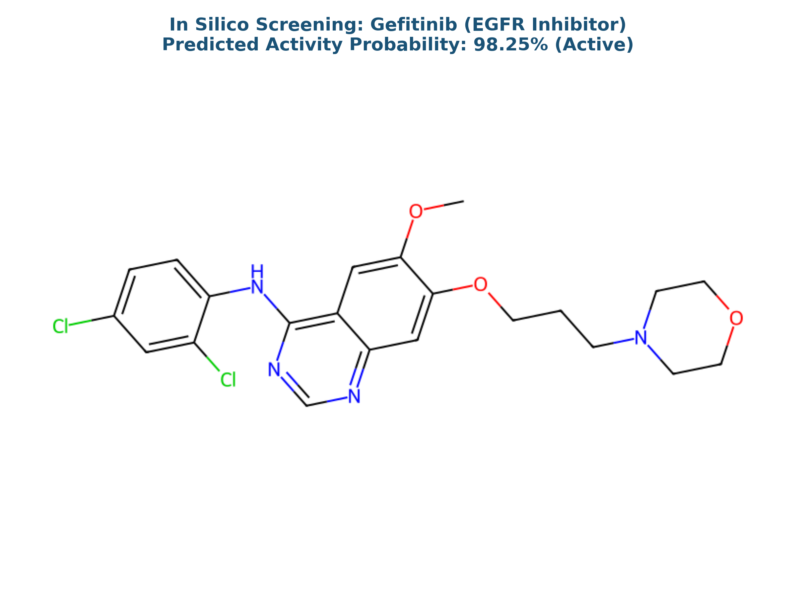

# 🧬 End-to-End QSAR Modeling Pipeline for EGFR (CHEMBL203) Bioactivity Prediction

[](https://egfr-qsar-pipeline-j3reqpn7hy2wxbzaxg3vhj.streamlit.app/)

> **🚀 Live Interactive Demo:** Test any SMILES string directly in your browser using the **[EGFR Bioactivity Predictor Web App](https://egfr-qsar-pipeline-j3reqpn7hy2wxbzaxg3vhj.streamlit.app/)**.

### Example Output (Gefitinib Reference Inhibitor)



[](https://www.python.org/)
[](https://www.rdkit.org/)
[](https://xgboost.readthedocs.io/)
[](https://www.ebi.ac.uk/chembl/)

A production-grade, reproducible Cheminformatics and Machine Learning pipeline designed to predict small-molecule bioactivity against the Epidermal Growth Factor Receptor (**EGFR / CHEMBL203**), a key oncology drug target. 

This project demonstrates robust data engineering (handling API rate-limiting and server timeouts), rigorous cheminformatics curation (RDKit), and high-performance predictive modeling (**ROC-AUC: 0.9163**).

---

## 🚀 Key Highlights & Engineering Features

- **Resilient Data Extraction (`ChEMBLDataFetcher`)**: Implements automated offset-based batching and intelligent rate-limiting/retry mechanisms to seamlessly bypass EBI REST API server timeouts (HTTP 500) during large-scale extractions.
- **Rigorous Data Curation (`DataCurator`)**: 
  - Canonicalization and sanitization of molecular structures using **RDKit**.
  - Unit harmonization ($uM$ to $nM$ conversion).
  - Removal of structural duplicates based on canonical SMILES.
  - Standardized activity binarization ($\le 1000 \text{ nM}$ threshold for active compounds).
- **Molecular Representation**: Generates high-dimensional **Morgan Fingerprints** (Radius = 2, 2,048 bits) to capture essential molecular substructures.
- **Predictive Modeling**: Trained using **XGBoost Classifier** with stratified data splitting to prevent class imbalance bias.

---

## 📊 Results & Performance

The optimized XGBoost model achieves exceptional predictive performance on the test set:

- **Test ROC-AUC Score**: `0.9163`
- **Accuracy**: `86%`
- **Class Balance**: 
  - **Actives ($\le 1,000 \text{ nM}$)**: Precision `0.89` | Recall `0.89`
  - **Inactives ($> 1,000 \text{ nM}$)**: Precision `0.79` | Recall `0.81`

---

## 🗂️ Project Structure

```text
├── egfr_curated_bioactivity.csv    # Cleaned and standardized dataset (1,087 compounds)
├── egfr_xgboost_model.pkl          # Serialized trained XGBoost model
├── qsar_pipeline.ipynb             # Main interactive Jupyter notebook
└── README.md  
```

git clone [https://github.com/gaetanolentini96/egfr-qsar-pipeline.git](https://github.com/gaetanolentini96/egfr-qsar-pipeline.git)
cd egfr-qsar-pipeline

conda install -c conda-forge rdkit xgboost chembl_webresource_client scikit-learn pandas job

import joblib
import numpy as np
from rdkit import Chem
from rdkit.Chem import AllChem

# Load model
model = joblib.load("egfr_xgboost_model.pkl")

# Predict a new molecule (e.g., Gefitinib SMILES)
smiles = "COc1cc2c(ncnc2cc1OCCCN3CCOCC3)Nc4ccc(cc4Cl)Cl"
mol = Chem.MolFromSmiles(smiles)
fp = np.array(AllChem.GetMorganFingerprintAsBitVect(mol, radius=2, nBits=2048))

prediction = model.predict([fp])[0]
probability = model.predict_proba([fp])[0][1]

print(f"Active Prediction: {'Active' if prediction == 1 else 'Inactive'} (Probability: {probability:.4f})")
